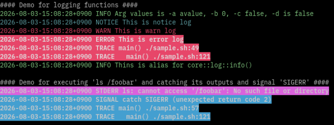

# Neobash

<div align="center">




</div>

構造化ロギング、自動 CLI 引数解析、ライブラリ管理、ビルトイン連携機能をシェルスクリプトに提供するモジュール型 Bash スクリプトフレームワークです。

## 目次

- [機能](#機能)
- [要件](#要件)
- [インストール](#インストール)
- [クイックスタート](#クイックスタート)
- [使い方](#使い方)
- [サンプル](#サンプル)
- [ライブラリドキュメント](#ライブラリドキュメント)
- [ディレクトリ構成](#ディレクトリ構成)
- [ライセンス](#ライセンス)
- [作者](#作者)

## 機能

- **ライブラリマネージャー** (`neobash.sh`) — ブートストラップ。必要に応じてライブラリを読み込むモジュール型の `import` / `require` システム。`nb::add_lib_path` によるカスタムライブラリパスの追加にも対応。
- **引数パーサー** (`core/arg.sh`) — シンプルな API でオプション、フラグ、型、デフォルト値、必須パラメータを定義。`--help` と `--version` の出力を自動生成。
- **構造化ロギング** (`core/log.sh`) — レベル付きロギング（DEBUG, INFO, NOTICE, WARN, ERROR, CRIT）。カラー対応の端末出力、JSON 形式のオプション、関数・ファイルごとのデバッグフィルタリング、スタックトレースを提供。
- **ビルトイン連携** —（実験的）エラーハンドリング、cURL、Mattermost、Markdown テーブル、文字列ユーティリティなど、すぐに使えるヘルパーを用意。

## 要件

- **Bash 4.2** 以上  
  *（一部のライブラリ、例えば `util/cmd.sh`、`util/catch-err.sh`、`util/series.sh` は `nameref` 機能を必要とするため Bash 4.3 以上が必要です。）*
- 特定のライブラリが使用する外部コマンド（例: `column`、`base64`、`sleep`、`kill`）

## インストール

```bash
git clone https://github.com/yourusername/neobash.git
cd neobash
```

ビルドステップは不要です。ブートストラップファイルを読み込むだけで使用可能です。

## クイックスタート

```bash
#!/usr/bin/env bash
source "$(cd "$(dirname "$(readlink -f "${BASH_SOURCE[0]}")")" >/dev/null 2>&1 && pwd)/lib/neobash.sh"

main() {
    core::arg::init_local
    core::arg::add_option -l "GREETING" -o "-g" -t "string" -r "true" -h "Greeting message"
    core::arg::parse "$@"

    core::log::info "Hello, ${ARGS[GREETING]}!"
}

main "$@"
```

実行:

```bash
./quickstart.sh -g "World"
```

## 使い方

標準的なワークフローは以下の通りです:

1. **ブートストラップ** — スクリプトの先頭で `lib/neobash.sh` を読み込みます。
2. **ライブラリのインポート** — `nb::import "name"` を使用するか、自動読み込みされるコアライブラリ（`core/log.sh`、`core/arg.sh`）を利用します。
3. **CLI の定義** — `core::arg::*` 関数を使ってオプションとフラグを宣言します。
4. **解析** — `core::arg::parse "$@"` を呼び出し、グローバルな連想配列 `ARGS` に値を格納します。
5. **ログ出力と実行** — `core::log::info`、`core::log::warn` などを使い、通常のスクリプトロジックを記述します。

### ロギング用環境変数

| 変数 | 型 | デフォルト | 説明 |
|------|------|---------|-------------|
| `LOG_DEBUG` | bool | `false` | すべてのデバッグログを出力する |
| `LOG_DEBUG_FUNC` | string | `""` | 指定した関数名のデバッグログのみ出力する |
| `LOG_DEBUG_FILE` | string | `""` | 指定したファイル名のデバッグログのみ出力する |
| `LOG_FORMAT` | string | `"plain"` | ログ形式を選択: `"plain"` または `"json"` |


## サンプル

完全に動作するサンプルは [`sample.sh`](sample.sh) に含まれています。

### ヘルプメッセージの表示

```bash
./sample.sh -h
```

```text
This is sample.sh for neobash.
You can use it to read 'source lib/neobash.sh' command.

Usage:

   ## Options, Flags
   -a --a-option [string]               (required): This is -a string option.
                                                    You can insert line break.
   -b [int]                             (optional): This is -b int option with default.   DEFAULT: "0"
   -c [bool]                            (optional): This is -c bool option with no default.   DEFAULT: "false"
   -d                                   (flag)    : This is -d flag. ARG_D will be true if it's set.
   -e --e-option [string]               (optional): This is --e-option string option   DEFAULT: ""

   ## Global Flags
   -h, --help                           (flag)    : show help message
   -v, --version                        (flag)    : show version
   --debug                              (flag)    : print all debug logs but until the arg is parsed, no debug logs will be shown.

   ## Global Main Environment Variables for logging
   LOG_DEBUG=[bool]                     print all debug logs   DEFAULT: "false"
   LOG_DEBUG_FUNC=[string]              print debug logs for the specified function names   DEFAULT: ""
   LOG_DEBUG_FILE=[string]              print debug logs for the specified file names   DEFAULT: ""
   LOG_FORMAT=["plain"|"json"]          select log format   DEFAULT: "plain"
```

### サンプルの実行

```bash
./sample.sh -a avalue
```

```text
#### Demo for arguments parser ####
##### Show all options and flags for main()
label  short option  long option  type    required  store  default  help message
ARG_A  -a            --a-option   string  true      none   ""       "This is -a string option.\nYou can insert line break."
ARG_B  -b                         int     false     none   "0"      "This is -b int option with default."
ARG_C  -c                         bool    false     none   "false"  "This is -c bool option with no default."
ARG_D  -d                         bool    false     true   "false"  "This is -d flag. ARG_D will be true if it's set."
ARG_E  -e            --e-option   string  false     none   ""       "This is --e-option string option"
#### Show all labels and values for main()
ARG_A=avalue
ARG_B=0
ARG_C=false
ARG_D=false
ARG_E=
OTHER ARGS=

#### Demo for logging functions ####
2026-08-08-15:37:46+0900 INFO Arg values is -a avalue, -b 0, -c false, -d is false
2026-08-08-15:37:46+0900 NOTICE This is notice log
2026-08-08-15:37:46+0900 WARN This is warn log
2026-08-08-15:37:46+0900 ERROR This is error log
2026-08-08-15:37:46+0900 TRACE main() ./sample.sh:49
2026-08-08-15:37:46+0900 TRACE   main() ./sample.sh:121
2026-08-08-15:37:46+0900 INFO This is alias for core::log::info()

#### Demo for executing 'ls /foobar' and catching its outputs and signal 'SIGERR' ####
2026-08-08-15:37:46+0900 STDERR ls: cannot access '/foobar': No such file or directory
2026-08-08-15:37:46+0900 SIGNAL catch SIGERR (unexpected return code 2)
2026-08-08-15:37:46+0900 TRACE main() ./sample.sh:57
2026-08-08-15:37:46+0900 TRACE   main() ./sample.sh:121

#### Demo for core::log::stack_trace() ####
2026-08-08-15:37:46+0900 TRACE main() ./sample.sh:61
2026-08-08-15:37:46+0900 TRACE   main() ./sample.sh:121

#### Demo for core::log::echo() and core::log::echo_err() ####
This is stdout message
This is stderr message

#### Demo for nb::get_libs() to show all imported libraries. ####
2026-08-08-15:37:46+0900 INFO imported libs: neobash.sh core/log.sh core/arg.sh

#### Demo for checking whether specified library is imported or not ####
2026-08-08-15:37:46+0900 INFO core/log.sh is imported

#### Demo for importing util/cmd.sh and call util::cmd::exec() ####
2026-08-08-15:37:46+0900 INFO importing util/cmd.sh
2026-08-08-15:37:47+0900 INFO sub_function() stdout is "This is stdout in sub()"
2026-08-08-15:37:47+0900 INFO sub_function() stderr is "This is stderr in sub()"

#### Demo for array serialization ####
ARRAY_ORG=
a1 a2 a3

ARRAY_SERIALIZED=
array
MA==:YTE=
MQ==:YTI=
Mg==:YTM=

ARRAY_DECODED=
a1 a2 a3
```

ターミナルではログ出力がカラー表示されます。

### すべてのデバッグメッセージを表示して実行

```bash
LOG_DEBUG=true ./sample.sh -a avalue
```

### `sample.sh` のデバッグログのみ表示して実行

```bash
LOG_DEBUG_FILE="sample.sh" ./sample.sh -a avalue
```

## ライブラリドキュメント

完全なドキュメントは以下の言語で利用可能です:

- [English](doc/en/README.md)
- [日本語](doc/ja/README.md)

## ディレクトリ構成

```
neobash/
├── lib/                  # コアおよび拡張ライブラリ
│   ├── neobash.sh        # ブートストラップ & ライブラリマネージャー
│   ├── core/             # コアライブラリ（log, arg）
│   ├── (other categorizd libraries)
├── doc/                  # ドキュメント（EN / JA）
├── test/                 # テストスイート
├── bin/                  # 開発用ヘルパーツール
├── sample.sh             # 完全に動作するデモスクリプト
├── sample_color_term.png # ターミナルスクリーンショット
└── LICENSE               # MIT ライセンス
```

## ライセンス

このプロジェクトは [MIT License](LICENSE) の下でライセンスされています。

## 作者

MATSUO Takatoshi — [matsuo.tak@gmail.com](mailto:matsuo.tak@gmail.com)
