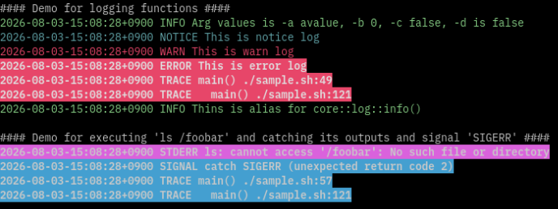

# Neobash

[🇯 🇵  日本語版はこちら](README-ja.md)

<div align="center">




</div>

A modular Bash scripting framework that brings structured logging, automatic CLI argument parsing, library management, and built-in integrations to your shell scripts.

## Table of Contents

- [Features](#features)
- [Requirements](#requirements)
- [Installation](#installation)
- [Quick Start](#quick-start)
- [Usage](#usage)
- [Sample](#sample)
- [Library Documentation](#library-documentation)
- [Directory Structure](#directory-structure)
- [License](#license)
- [Author](#author)

## Features

- **Library Manager** (`neobash.sh`) — Bootstrap. Modular `import` / `require` system for loading libraries on demand. Supports custom library paths via `nb::add_lib_path`.
- **Argument Parser** (`core/arg.sh`) — Define options, flags, types, defaults, and required parameters with a concise API. Automatically generates `--help` and `--version` output.
- **Structured Logging** (`core/log.sh`) — Leveled logging (DEBUG, INFO, NOTICE, WARN, ERROR, CRIT) with colorized terminal output, optional JSON format, per-function/file debug filtering, and stack traces.
- **Built-in Integrations** — (Exprimental) Ready-to-use helpers for Error handling, cURL, Mattermost, Markdown tables, string utilities, and so on.

## Requirements

- **Bash 4.2** or higher  
  *(Some libraries such as `util/cmd.sh`, `util/catch-err.sh`, and `util/series.sh` require Bash 4.3+ for `nameref` support.)*
- External commands used by specific libraries (e.g. `column`, `base64`, `sleep`, `kill`)

## Installation

```bash
git clone https://github.com/yourusername/neobash.git
cd neobash
```

No build step is required. Just source the bootstrap file.

## Quick Start

```bash
#!/usr/bin/env bash
source "$(cd "$(dirname "$(readlink -f "${BASH_SOURCE[0]}")")" >/dev/null 2>&1 && pwd)/lib/neobash.sh"

main() {
    core::arg::init_local
    core::arg::add_option -l "GREETING" -o "-g" -t "string" -r "true" -h "Greeting message"
    core::arg::parse "$@"

    core::log::info "Hello, ${ARGS[GREETING]}!"
}

main "$@"
```

Run it:

```bash
./quickstart.sh -g "World"
```

## Usage

The typical workflow is:

1. **Bootstrap** — Source `lib/neobash.sh` at the top of your script.
2. **Import libraries** — Use `nb::import "name"` or rely on the auto-loaded core libraries (`core/log.sh`, `core/arg.sh`).
3. **Define CLI** — Use `core::arg::*` functions to declare options and flags.
4. **Parse** — Call `core::arg::parse "$@"` to populate the global `ARGS` associative array.
5. **Log & run** — Use `core::log::info`, `core::log::warn`, etc. and normal script logic.

### Environment Variables for Logging

| Variable | Type | Default | Description |
|----------|------|---------|-------------|
| `LOG_DEBUG` | bool | `false` | Print all debug logs |
| `LOG_DEBUG_FUNC` | string | `""` | Print debug logs only for the specified function names |
| `LOG_DEBUG_FILE` | string | `""` | Print debug logs only for the specified file names |
| `LOG_FORMAT` | string | `"plain"` | Select log format: `"plain"` or `"json"` |

## Sample

A fully working example is provided in [`sample.sh`](sample.sh).

### Show help message

```bash
./sample.sh -h
```

```text
This is sample.sh for neobash.
You can use it to read 'source lib/neobash.sh' command.

Usage:

   ## Options, Flags
   -a --a-option [string]               (required): This is -a string option.
                                                    You can insert line break.
   -b [int]                             (optional): This is -b int option with default.   DEFAULT: "0"
   -c [bool]                            (optional): This is -c bool option with no default.   DEFAULT: "false"
   -d                                   (flag)    : This is -d flag. ARG_D will be true if it's set.
   -e --e-option [string]               (optional): This is --e-option string option   DEFAULT: ""

   ## Global Flags
   -h, --help                           (flag)    : show help message
   -v, --version                        (flag)    : show version
   --debug                              (flag)    : print all debug logs but until the arg is parsed, no debug logs will be shown.

   ## Global Main Environment Variables for logging
   LOG_DEBUG=[bool]                     print all debug logs   DEFAULT: "false"
   LOG_DEBUG_FUNC=[string]              print debug logs for the specified function names   DEFAULT: ""
   LOG_DEBUG_FILE=[string]              print debug logs for the specified file names   DEFAULT: ""
   LOG_FORMAT=["plain"|"json"]          select log format   DEFAULT: "plain"
```

### Run the sample

```bash
./sample.sh -a avalue
```

```text
#### Demo for arguments parser ####
##### Show all options and flags for main()
label  short option  long option  type    required  store  default  help message
ARG_A  -a            --a-option   string  true      none   ""       "This is -a string option.\nYou can insert line break."
ARG_B  -b                         int     false     none   "0"      "This is -b int option with default."
ARG_C  -c                         bool    false     none   "false"  "This is -c bool option with no default."
ARG_D  -d                         bool    false     true   "false"  "This is -d flag. ARG_D will be true if it's set."
ARG_E  -e            --e-option   string  false     none   ""       "This is --e-option string option"
#### Show all labels and values for main()
ARG_A=avalue
ARG_B=0
ARG_C=false
ARG_D=false
ARG_E=
OTHER ARGS=

#### Demo for logging functions ####
2026-08-08-15:37:46+0900 INFO Arg values is -a avalue, -b 0, -c false, -d is false
2026-08-08-15:37:46+0900 NOTICE This is notice log
2026-08-08-15:37:46+0900 WARN This is warn log
2026-08-08-15:37:46+0900 ERROR This is error log
2026-08-08-15:37:46+0900 TRACE main() ./sample.sh:49
2026-08-08-15:37:46+0900 TRACE   main() ./sample.sh:121
2026-08-08-15:37:46+0900 INFO This is alias for core::log::info()

#### Demo for executing 'ls /foobar' and catching its outputs and signal 'SIGERR' ####
2026-08-08-15:37:46+0900 STDERR ls: cannot access '/foobar': No such file or directory
2026-08-08-15:37:46+0900 SIGNAL catch SIGERR (unexpected return code 2)
2026-08-08-15:37:46+0900 TRACE main() ./sample.sh:57
2026-08-08-15:37:46+0900 TRACE   main() ./sample.sh:121

#### Demo for core::log::stack_trace() ####
2026-08-08-15:37:46+0900 TRACE main() ./sample.sh:61
2026-08-08-15:37:46+0900 TRACE   main() ./sample.sh:121

#### Demo for core::log::echo() and core::log::echo_err() ####
This is stdout message
This is stderr message

#### Demo for nb::get_libs() to show all imported libraries. ####
2026-08-08-15:37:46+0900 INFO imported libs: neobash.sh core/log.sh core/arg.sh

#### Demo for checking whether specified library is imported or not ####
2026-08-08-15:37:46+0900 INFO core/log.sh is imported

#### Demo for importing util/cmd.sh and call util::cmd::exec() ####
2026-08-08-15:37:46+0900 INFO importing util/cmd.sh
2026-08-08-15:37:47+0900 INFO sub_function() stdout is "This is stdout in sub()"
2026-08-08-15:37:47+0900 INFO sub_function() stderr is "This is stderr in sub()"

#### Demo for array serialization ####
ARRAY_ORG=
a1 a2 a3

ARRAY_SERIALIZED=
array
MA==:YTE=
MQ==:YTI=
Mg==:YTM=

ARRAY_DECODED=
a1 a2 a3
```

In terminal, the log output is colorized.

### Run with all debug messages

```bash
LOG_DEBUG=true ./sample.sh -a avalue
```

### Run with debug log for `sample.sh` only

```bash
LOG_DEBUG_FILE="sample.sh" ./sample.sh -a avalue
```

## Library Documentation

Full documentation is available in multiple languages:

- [English](doc/en/README.md)
- [日本語](doc/ja/README.md)

## Directory Structure

```
neobash/
├── lib/                  # Core and extended libraries
│   ├── neobash.sh        # Bootstrap & library manager
│   ├── core/             # Core libraries (log, arg)
│   ├── (other categorizd libraries)
├── doc/                  # Documentation (EN / JA)
├── test/                 # Test suite
├── bin/                  # Helper tools for development
├── sample.sh             # Fully working demo script
├── sample_color_term.png # Terminal screenshot
└── LICENSE               # MIT License
```

## License

This project is licensed under the [MIT License](LICENSE).

## Author

MATSUO Takatoshi — [matsuo.tak@gmail.com](mailto:matsuo.tak@gmail.com)
